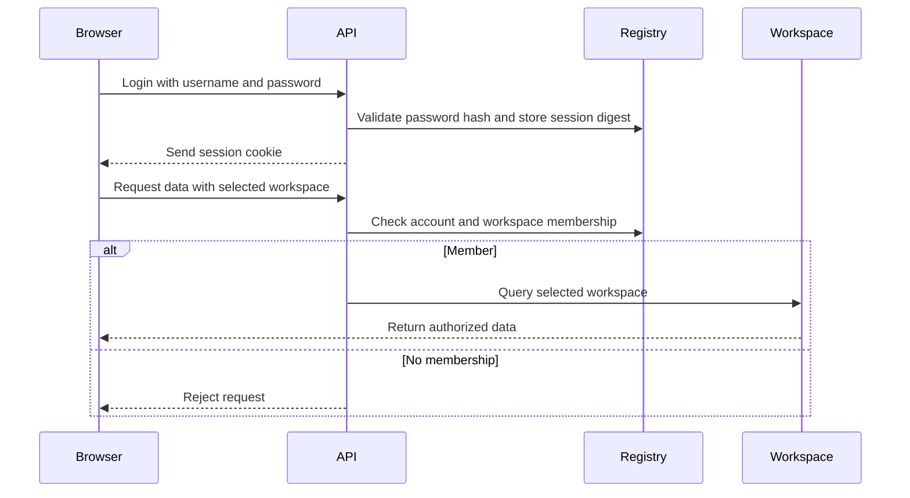

# API guide

English · [简体中文](API.zh-CN.md)

The application serves its API and frontend from the same origin. JSON endpoints return an object or a list directly. Error responses include a stable `code` and a localized `detail`. Field validation errors can include an `errors` array. Before login, the server negotiates error language with `Accept-Language`. Authenticated errors use the workspace language. Use the session cookie on subsequent requests. A browser mutation must have a matching origin.

Send `X-DayWeave-Workspace` to select a workspace for a request. The server verifies membership every time. Browser clients can include `X-DayWeave-Account` to reject a stale tab if the cookie changes after a separate sign-in. Profile settings and provider credentials follow the authenticated account.



## Workspace endpoints

| Method and path | Behavior |
| --- | --- |
| `GET /api/health` | Verify that the service can query the migrated database |
| `GET /api/auth/status` | Read `authenticated`, `signup_enabled` and the signed-in account's ID, username and verified email |
| `POST /api/auth/email-code` | Send `email` and `purpose` (`register` or `reset`). The endpoint waits for the relay before returning 202. Existing and unknown addresses receive the same acceptance body. A relay failure returns 503 and permits an immediate retry. An overlapping request still awaiting submission returns 409. |
| `POST /api/auth/register` | Send `username`, `email`, `password` (10 or more characters), and the emailed `code` as an eight-digit string. Creates the account, personal workspace and session. |
| `POST /api/auth/reset-password` | Send `email`, the reset `code` and a new `password`. Success returns 204 and revokes all sessions for that account. |
| `POST /api/auth/login`, `POST /api/auth/logout` | Sign in by passing a username or email in `username` with the password, or invalidate the current session. |
| `GET, POST /api/workspaces` | List accessible workspaces or create another workspace |
| `GET, POST /api/workspaces/{id}/members` | As owner, list members or add an existing username |
| `DELETE /api/workspaces/{id}/members/{account_id}` | As owner, remove a member |
| `GET /api/dashboard/today` | Local date, focus tasks, scheduled tasks, linked resources and reminder groups |
| `GET, POST /api/tasks` | Filter tasks or create a task |
| `GET, PATCH, DELETE /api/tasks/{id}` | Read, edit or soft-delete a task |
| `PATCH /api/tasks/{id}/schedule` | Update the plan using the task's `expected_updated_at` value. Returns `task` and its `change_id` |
| `GET, POST /api/projects` | List projects or create a project |
| `GET, PATCH, DELETE /api/projects/{id}` | Read project details with linked tasks and resources, update or delete |
| `GET, POST /api/resources` | List or create resources. Link records are reusable by URL |
| `GET, PATCH, DELETE /api/resources/{id}` | Read, update progress or metadata, or delete |
| `POST /api/resources/upload` | Multipart upload with `file` and optional `title`. Up to 25 MiB per file |
| `GET /api/resources/{id}/file` | Open the stored upload for an authenticated user |
| `GET, PATCH /api/settings` | Read or change workspace preferences |
| `GET /api/changes` | Read recent mutations with before/after snapshots |
| `POST /api/changes/{id}/undo` | Undo an eligible change. A newer active edit to the same object prevents stale restoration |
| `GET /api/export` | Export portable business data and transcripts as JSON |

Use `view=inbox|today|tomorrow|week|next_week|month|upcoming|all|completed` on the task list. Optional filters include `q`, `project_id`, `category`, `priority`, `status`, `scheduled_date` and `due_date`. Deletes require `?confirm=true`. A schedule/deadline conflict returns HTTP 409. An intentional exception can be saved with `allow_due_conflict: true` after a user decision.

Read historical assignments with `GET /api/planner/history?start=YYYY-MM-DD&end=YYYY-MM-DD`. Dates are inclusive and at most 62 days apart. Each row has the original task ID and `is_past_plan: true`. On the first workspace access after the assigned day, the server records the expired plan and releases its task to the backlog in one transaction. The calendar uses the workspace timezone. Completed tasks retain their last scheduled date.

To reserve a task for an undetermined day in a week, send `{"expected_updated_at":"<current task.updated_at>","planning_window":"week","window_start":"2026-11-23"}` to the schedule endpoint. For a month use `"planning_window":"month"` and its first date, such as `2026-12-01`. For an exact day, supply `scheduled_date` and optional `scheduled_period`, `planned_start_at` or `planned_end_at`. Use the timestamp from the returned task for subsequent changes. A stale timestamp prevents overwriting newer work.

Set the workspace language with `PATCH /api/settings` and `{"language":"en"}`. Supported values are `zh-CN`, `ja` and `en`. Language selection leaves stored user content, local timezone and domain identifiers intact.

### Task example

```json
{
  "title": "Study ROS 2 tracing",
  "priority": "high",
  "scheduled_date": "2026-11-23",
  "scheduled_period": "afternoon",
  "estimated_minutes": 60,
  "due_date": "2026-11-27",
  "resource_ids": []
}
```

Send the example to `POST /api/tasks`. To complete its returned ID, send `{"status":"done"}` to `PATCH /api/tasks/{id}`. Separate deadline representations preserve calendar precision. Exact timestamps must carry an offset. Resource progress uses seconds for videos, pages for PDFs and percent for other types.

## Assistant endpoints

| Method and path | Behavior |
| --- | --- |
| `GET /api/ai/providers` | Read provider status and available model metadata |
| `PATCH /api/ai/providers/{id}` | Set credentials and provider defaults. The key is write-only |
| `POST /api/ai/providers/{id}/test` | Authenticate and fetch the live model catalog. Check the returned provider status |
| `GET /api/ai/models?provider={id}&model={model}` | Read cached account models and supported reasoning values |
| `POST /api/ai/chat` | Start or continue a conversation and read its server-sent events |
| `GET /api/ai/conversations`, `GET /api/ai/conversations/{id}` | List stored conversations or read one transcript |
| `GET /api/ai/confirmations/{id}` | Read the current proposal and revision |
| `PATCH /api/ai/confirmations/{id}/draft` | Save changed task-draft fields and return the new revision |
| `POST /api/ai/confirmations/{id}` | Approve or cancel. Task drafts require the reviewed `version` with the decision |
| `GET /api/ai/chatgpt/guide`, `POST /api/ai/chatgpt/disconnect` | Retrieve official setup guidance or disconnect the registration |
| `POST /api/ai/codex/login`, `GET /api/ai/codex/login`, `POST /api/ai/codex/disconnect` | Start or poll device login for the current account, or remove its local Codex grant. Pending responses include a private verification URL and user code. |

A chat request includes `content` and a unique `request_id`. Optional fields include `provider`, `model`, `reasoning` and `conversation_id`. Reuse a request ID only for the same request. Each SSE frame has a JSON `data` object with a `type` field. Common types are `conversation`, `delta`, `tool`, `task_draft`, `confirmation`, `usage`, `error` and `done`.

Each `usage` event is a cumulative snapshot for this user turn. Read `usage.total_tokens`, `input_tokens`, `output_tokens` and `partial`. A partial total covers only calls with a provider report. Missing breakdowns or unavailable usage are null. The final snapshot is stored as `token_usage` on the assistant message and reused on replay. The task field `due_period` accepts `morning`, `afternoon` or `evening` alongside `due_date`. Exact deadlines use `due_at`.

### Editable task drafts

1. A `task_draft` event contains a proposal `id`, `version`, `status`, `conflict` flag and a `drafts` array. Each item supplies the original `index`, proposed `task` fields and optional `resource` metadata. The task and any proposed new resource are still pending.
2. To edit the first item in version 1, send `{"version":1,"drafts":[{"index":0,"task":{"title":"Prepare notes","estimated_minutes":45}}]}` to `PATCH /api/ai/confirmations/{id}/draft`. Use the revision returned by the server for the next request. A stale revision returns HTTP 409. The edited card is persisted in the transcript.
3. To create the task, post `{"approve":true,"version":2}` with the actual current revision. If the reviewed schedule conflicts with its deadline, the user can explicitly set `allow_due_conflict:true`. To cancel, send `{"approve":false,"version":2}`. The response contains `status`, `result` and the updated `event`. Approved items include their saved `task_id`; the task list is unchanged after cancellation.
