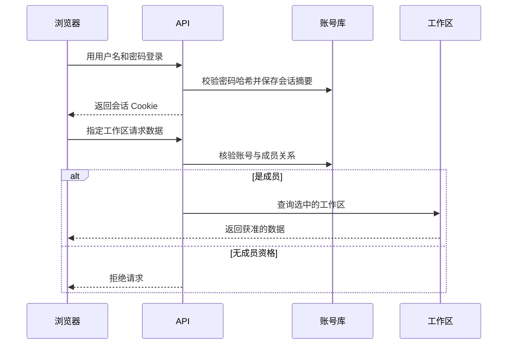

# API 说明

[English](API.md) · 简体中文

应用从同一源提供 API 和前端。JSON 接口直接返回对象或列表。错误响应包含稳定的 `code` 和本地化的 `detail` 字段，字段校验失败时还可能包含 `errors` 数组。登录前，服务端根据 `Accept-Language` 协商错误提示语言。登录后使用工作区语言，后续请求应携带会话 Cookie。浏览器执行写操作时，请求的来源必须与应用匹配。

通过 `X-DayWeave-Workspace` 指定本次请求的工作区，服务端每次核验成员关系。浏览器可携带 `X-DayWeave-Account`，避免另一次登录更换 Cookie 后，旧标签页继续提交。个人偏好与服务商凭据跟随已登录账号。



## 工作区接口

| 方法与路径 | 行为 |
| --- | --- |
| `GET /api/health` | 验证服务能否查询已迁移的数据库 |
| `GET /api/auth/status` | 读取 `authenticated`、`signup_enabled` 及已登录账号的ID、用户名和绑定邮箱 |
| `POST /api/auth/email-code` | 提交邮箱和用途（register 或 reset）。发信请求等待邮件服务响应。受理后返回 202，已存在与未知邮箱的受理响应相同。邮件服务故障时返回 503，可立即重试；同一请求仍在发送时返回 409。 |
| `POST /api/auth/register` | 提交 `username`、`email`、至少十个字符的 `password` 和八位数字字符串 `code`，成功后创建账号、个人工作区与会话。 |
| `POST /api/auth/reset-password` | 提交 `email`、找回密码用的 `code` 以及新 `password`，成功返回 204 并撤销该账号的所有会话。 |
| `POST /api/auth/login`、`POST /api/auth/logout` | 在 `username` 字段填写用户名或邮箱，凭密码登录；注销时结束当前会话。 |
| `GET, POST /api/workspaces` | 列出可访问的工作区，或创建新工作区 |
| `GET, POST /api/workspaces/{id}/members` | 所有者列出成员或添加已有用户名 |
| `DELETE /api/workspaces/{id}/members/{account_id}` | 所有者移除成员 |
| `GET /api/dashboard/today` | 返回本地日期、重点任务、当天任务、关联资料和提醒分组 |
| `GET, POST /api/tasks` | 筛选任务或创建任务 |
| `GET, PATCH, DELETE /api/tasks/{id}` | 读取、编辑或软删除任务 |
| `PATCH /api/tasks/{id}/schedule` | 通过任务的 `expected_updated_at` 更新计划，返回 `task` 和变更的 `change_id` |
| `GET, POST /api/projects` | 列出项目或创建项目 |
| `GET, PATCH, DELETE /api/projects/{id}` | 读取带关联任务与资料的项目详情、更新或删除项目 |
| `GET, POST /api/resources` | 列出或创建资料，可按 URL 复用链接记录 |
| `GET, PATCH, DELETE /api/resources/{id}` | 读取资料、更新进度及元数据或删除资料 |
| `POST /api/resources/upload` | 使用 multipart 上传，字段为 `file` 和可选的 `title`，单文件上限 25 MiB |
| `GET /api/resources/{id}/file` | 已认证用户打开保存的上传文件 |
| `GET, PATCH /api/settings` | 读取或修改工作区偏好 |
| `GET /api/changes` | 读取近期写操作，包括修改前后快照 |
| `POST /api/changes/{id}/undo` | 撤销符合条件的变更；对象已有更新的有效修改时会阻止过期恢复 |
| `GET /api/export` | 以 JSON 导出可移植的业务数据与聊天记录 |

任务列表支持 `view=inbox|today|tomorrow|week|next_week|month|upcoming|all|completed`，可选筛选参数包括 `q`、`project_id`、`category`、`priority`、`status`、`scheduled_date` 和 `due_date`。删除需要 `?confirm=true`。计划与截止要求冲突时返回 HTTP 409。用户决定保留冲突后，可显式提交 `allow_due_conflict: true`。

要把任务暂放在某周而暂不指定日期，可向计划接口发送 `{"expected_updated_at":"<当前任务的 updated_at>","planning_window":"week","window_start":"2026-11-23"}`。按月安排时，使用 `"planning_window":"month"` 并传入该月第一天，例如 `2026-12-01`。安排到具体日期时传入 `scheduled_date`，并可补充 `scheduled_period`、`planned_start_at` 或 `planned_end_at`。后续修改使用返回任务的新时间戳，以防过期提交覆盖新安排。

向 `PATCH /api/settings` 发送 `{"language":"en"}` 可以设置工作区语言。支持 `zh-CN`、`ja` 和 `en`。切换语言会保留已有用户内容、时区及业务标识。

通过 `GET /api/planner/history?start=YYYY-MM-DD&end=YYYY-MM-DD` 读取含首尾日期的安排历史，起止相差最多 62 天。每条记录含原任务 ID 和 `is_past_plan: true`。执行日过后首次访问工作区时，服务端在同一事务里记录过去的安排并将未完成的任务移回待安排。日界线使用工作区时区，已完成任务保留最后一个执行日。

### 任务示例

```json
{
  "title": "学习 ROS 2 tracing",
  "priority": "high",
  "scheduled_date": "2026-11-23",
  "scheduled_period": "afternoon",
  "estimated_minutes": 60,
  "due_date": "2026-11-27",
  "resource_ids": []
}
```

将示例发给 `POST /api/tasks`。取返回的任务 ID，向 `PATCH /api/tasks/{id}` 发送 `{"status":"done"}` 即可完成任务。不同截止字段保留各自的时间精度。精确时间戳必须携带时区偏移。视频进度用秒、PDF 用页码，其他资料默认用百分比。

## 助手接口

| 方法与路径 | 行为 |
| --- | --- |
| `GET /api/ai/providers` | 读取服务商状态与可用模型信息 |
| `PATCH /api/ai/providers/{id}` | 设置凭据及服务商默认值，API Key 为只写字段 |
| `POST /api/ai/providers/{id}/test` | 使用凭据验证并获取实时模型目录，连接结果见返回的服务商状态 |
| `GET /api/ai/models?provider={id}&model={model}` | 读取缓存的账号模型目录与支持的推理档位 |
| `POST /api/ai/chat` | 开始或继续会话，读取服务端发送事件 |
| `GET /api/ai/conversations`、`GET /api/ai/conversations/{id}` | 列出持久化会话或读取指定聊天记录 |
| `GET /api/ai/confirmations/{id}` | 读取当前提案及其版本 |
| `PATCH /api/ai/confirmations/{id}/draft` | 保存变动的任务草稿字段，返回新版本 |
| `POST /api/ai/confirmations/{id}` | 确认或取消；任务草稿必须带上已审阅的 `version` |
| `GET /api/ai/chatgpt/guide`、`POST /api/ai/chatgpt/disconnect` | 取得官方配置说明或断开授权 |
| `POST /api/ai/codex/login`, `GET /api/ai/codex/login`, `POST /api/ai/codex/disconnect` | 为当前账号发起或查询设备登录，或移除本地 Codex 授权。等待授权时会返回该账号专用的验证链接和设备码。 |

聊天请求应包含 `content` 和唯一的 `request_id`。可选字段包括 `provider`、`model`、`reasoning` 与 `conversation_id`。只有重试同一请求时才复用请求 ID。每个 SSE 帧的 `data` 为带有 `type` 字段的 JSON 对象。常见类型包括 `conversation`、`delta`、`tool`、`task_draft`、`confirmation`、`usage`、`error` 和 `done`。

每个 `usage` 事件是当前轮次的累计快照，包含 `total_tokens`、`input_tokens`、`output_tokens` 和 `partial`。`partial` 为真时只汇总有服务商回报的调用。未提供的明细或用量为 null。最终快照保存在助手消息的 `token_usage` 中，重放时复用。任务的 `due_period` 可与 `due_date` 一起使用，取值为 `morning`、`afternoon` 或 `evening`。精确截止时刻使用 `due_at`。

### 可编辑的任务草稿

1. `task_draft` 事件包含提案 `id`、`version`、`status`、`conflict` 标记和 `drafts` 数组。每项包含原始 `index`、拟创建任务的 `task` 字段和可选的 `resource` 元数据。此时任务和拟新增的资料都处于待确认状态。
2. 编辑版本 1 的第一项时，向 `PATCH /api/ai/confirmations/{id}/draft` 发送 `{"version":1,"drafts":[{"index":0,"task":{"title":"整理笔记","estimated_minutes":45}}]}`。下一次请求使用服务端返回的版本。过期版本返回 HTTP 409。修改后的卡片会同步保存到聊天记录。
3. 创建任务时提交 `{"approve":true,"version":2}`，其中版本替换为实际的最新值。计划与截止要求冲突时，用户可明确设置 `allow_due_conflict:true`。取消则提交 `{"approve":false,"version":2}`。返回对象包含 `status`、`result` 和更新后的 `event`。已创建条目带有实际的 `task_id`；取消后任务列表保留原状。
