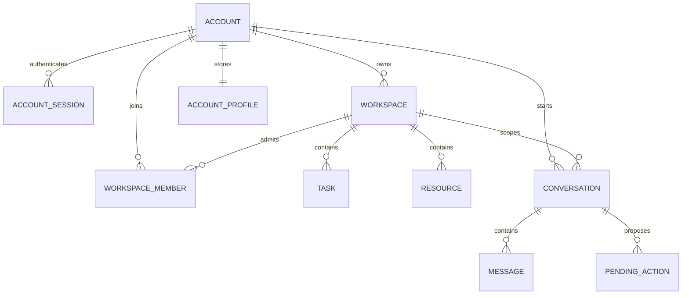
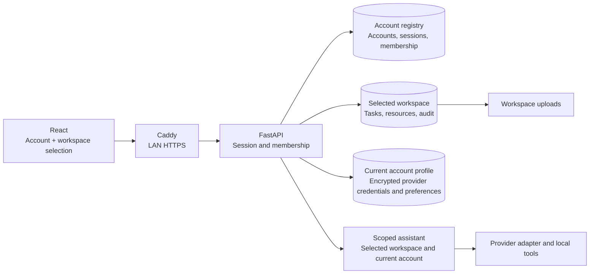
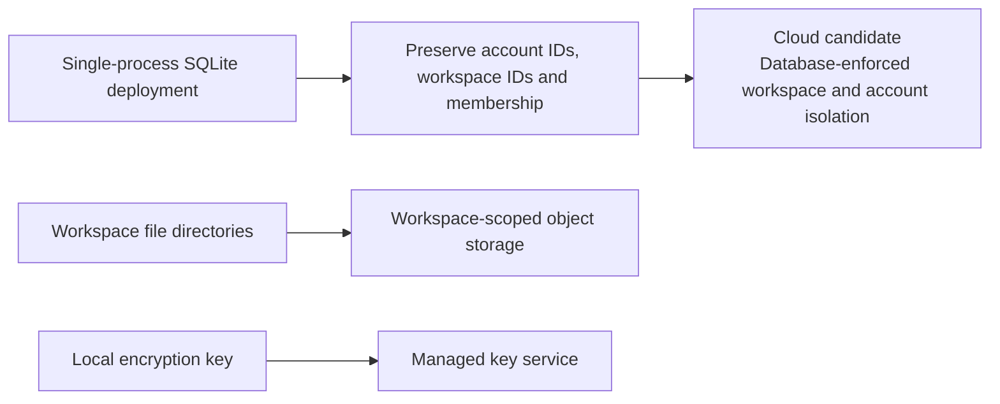

# Architecture

English · [简体中文](ARCHITECTURE.zh-CN.md)

## Deployment

A multi-stage image builds React with Node and runs FastAPI on Python. Uvicorn serves the REST API, the chat event stream and the compiled frontend from one origin. A single process owns the SQLite workload. The Compose volume at `/data` holds the account registry, workspace databases, uploads and the provider encryption key. The initial installation has no accounts or records unless an operator provisions an account.

## Accounts and storage isolation

Accounts and workspaces have separate UUIDs. Registration creates a personal workspace. An account can create additional workspaces and join shared workspaces. Owners add and remove members. A workspace owns its tasks, projects, resources and calendar timezone. An account's provider credentials, model defaults and other personal preferences follow it across workspaces. Conversations and pending actions are private to the account that created them within the selected workspace.

The server checks membership using the signed-in session and selected workspace. Browser requests carry the account and workspace that opened the view. A stale tab with a different account's cookie cannot apply its pending edits. Files are resolved only through resource records in the selected workspace database.

The registry stores versioned salted scrypt hashes and SHA-256 digests of random session tokens. SQLite stores the registry, each workspace and each account profile in separate files under `/data`. A cloud deployment can preserve their IDs and replace these storage boundaries with a registry database, database-enforced tenancy, workspace-scoped object storage and managed keys. It also needs a shared rate limiter and signup and recovery policies for its environment.

## Request flow

The browser uses React Router for navigation and TanStack Query for server state. An authenticated mutation reaches a FastAPI handler. The domain service validates the complete proposed record, applies the update and records its history in the same transaction. An AI tool uses the same domain service. The browser refetches affected state after writes.

Chat crosses a separate boundary. A provider adapter translates model events into text and tool calls. The local executor validates tool arguments before calling services. The assistant's prose has no database privileges. Conversation history and tool outcomes are local records. Model calls use limited context and return incremental events over an authenticated HTTP stream.

Creating a task through chat first stores a versioned proposal and its typed conversation event. The browser edits fields directly in that message and sends changed values with the revision it read. The server validates them, advances the revision and updates the stored conversation card. Explicit approval creates the task and any associated resource in a single transaction. Replaying an approved proposal returns the original receipt. Cancellation stores a terminal card. The manual task editor continues to save directly.

## Localization

The frontend uses i18next with React subscriptions and the catalogs in `frontend/src/locales/{zh-CN,ja,en}.json`. A Vite/Babel source transform extracts UI messages, and the production build checks coverage across all three locales. Switching language updates the running interface. Localized views include login, workspace settings, draft fields and accessible control names. Calendar presentation follows the active locale while date calculations use the workspace timezone. Domain values such as `todo`, model slugs and ISO dates retain stable wire formats. Localized assistant instructions control the language of new replies. Original messages and user-entered titles remain verbatim.

## Time and scheduling

Calendar dates are local dates. An exact instant includes an offset on input and is stored in UTC. A date-only deadline stays a date through the API and the editor. Parts of day can be represented without choosing a clock time. Today and calendar views use the configured timezone. All weeks run Monday through Sunday. A task has one active plan, which can be a specific date or a floating week/month window. `window_start` stores the Monday of that week or the first day of that month. The scheduling API checks the version the client read before changing the plan. Repeated execution sessions for one task are a later schema extension.

## Data model

| Tables | Responsibilities |
| --- | --- |
| `tasks` | Title, state, priority, optional project, estimate, focus flag, schedule, deadline and completion |
| `projects` | Project metadata, state and optional target date |
| `resources` | Links or local uploads, source, notes, progress value and unit |
| `task_resources`, `resource_projects` | Many-to-many associations |
| `change_log` | Object identity, operation, before/after snapshots, origin, conversation and undo state |
| `user_settings` | Locale, timezone, theme, provider and planning defaults |
| `accounts`, `workspaces`, `account_sessions` | Global identity registry, workspace ownership, password hashes and expiring session-token digests |
| `ai_providers` | Endpoint, model, capability catalog, connection status and encrypted credential |
| `conversations`, `messages` | Local transcripts, provider/model identity and tool records |
| `ai_turns`, `ai_confirmations` | Request deduplication, editable draft payloads, revision numbers, confirmation state and applied results |

## Operational boundaries

File content, resource metadata and model output are untrusted data. Resource URLs open in the browser. Storing a link does not request its content on the server. Administrator-configured inference endpoints are a separate, explicit network destination. With AI disconnected, the core API and browser workflow remain available.

SQLite and uploaded files must be backed up as a set. The portable workspace export omits credentials. Full recovery requires the matching provider encryption key and a consistent copy of the data volume. See the [operating guide](../README.md).
