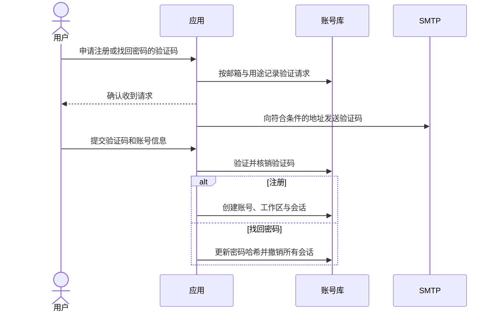
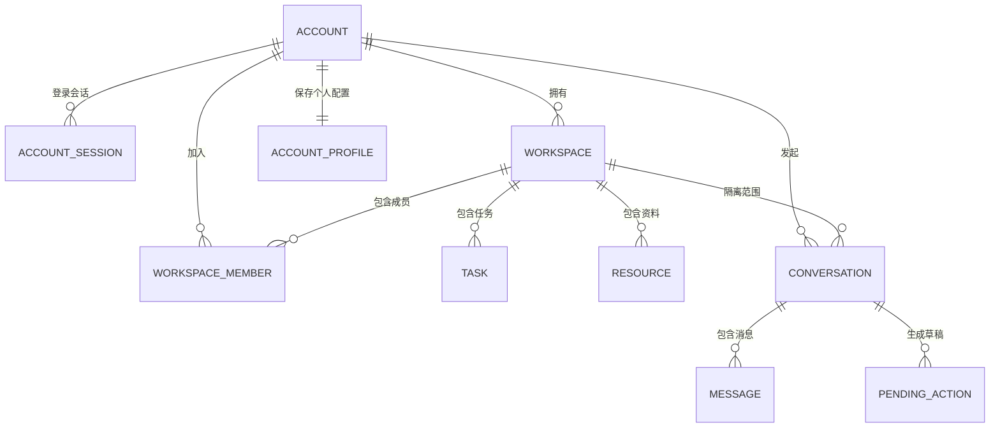
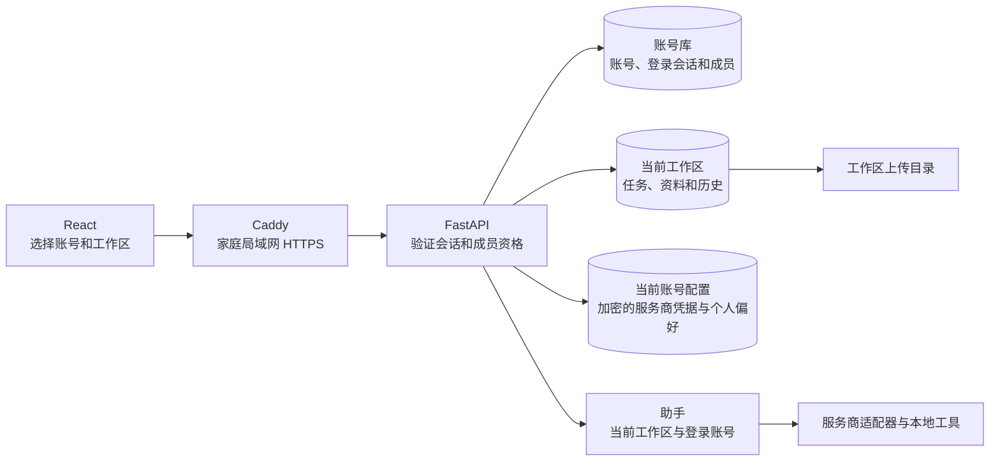
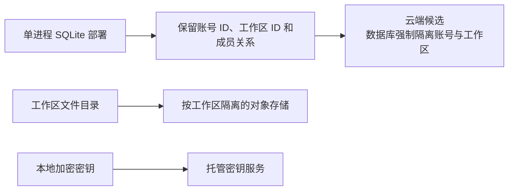

# 架构设计

[English](ARCHITECTURE.md) · 简体中文

## 部署

多阶段镜像先用 Node 构建 React 前端，再在 Python 环境中运行 FastAPI。Uvicorn 从同一源提供 REST API、聊天事件流和编译后的前端。单个应用进程处理 SQLite 工作负载。Compose 数据卷 `/data` 保存账号库、工作区数据库、上传文件和服务商加密密钥。首次启动数据为空，首位用户通过邮箱验证注册。

## 账号与数据隔离

账号和工作区各有独立的 UUID。注册时创建个人工作区，账号也可以创建更多工作区或加入共享工作区。所有者可以添加和移除成员。任务、项目、资料和日历时区属于工作区。服务商凭据、默认模型和其他个人偏好随账号切换工作区。会话和待确认操作仅在创建它的账号与当前工作区内可见。

账号库对规范化后的邮箱地址设唯一约束，按地址和用途保存验证码的密钥摘要。验证码十分钟内有效，连续输错五次后失效，一分钟后可以申请新码。验证码核销与账号变更在同一个事务内提交，重设密码后返回登录页。

服务端根据登录会话与选定工作区检查成员资格。浏览器请求携带打开界面时的账号和工作区。另一个账号取得 Cookie 后，旧标签页的待保存修改无法写入该账号。文件通过当前工作区数据库中的资料记录定位。

账号库保存带版本和盐值的 scrypt 密码哈希，以及随机会话令牌的 SHA-256 摘要。SQLite 把账号库、各工作区和各账号配置分别存放在 `/data`。云端可保留这些标识，采用数据库强制隔离、按工作区划分的对象存储与托管密钥，并配置共享限流、注册和账号恢复策略。

## 请求流程

浏览器用 React Router 导航，用 TanStack Query 管理服务端状态。通过认证的写请求进入 FastAPI 处理函数后，业务服务校验完整的拟写入记录，在同一事务中完成修改并记录历史。AI 工具也通过这一业务服务写入。写操作成功后，浏览器重新获取相关数据。

聊天通过独立的适配层调用模型。服务商适配器将模型事件转换为文本或工具调用，本地执行器在调用业务服务前校验参数。模型生成的文字本身没有数据库写入权限。会话历史与工具结果均保存在本地。模型请求只携带有限上下文，增量结果通过需要认证的 HTTP 事件流返回。

聊天创建任务时，服务端先保存带版本号的提案及其类型化会话事件。浏览器在消息中编辑字段，发送修改值和读取时的版本号。服务端校验修改、增加版本号，并更新历史卡片。用户明确确认后，服务端在单一事务中创建任务和任何待新增的关联资料。再次提交已确认的提案会返回原回执。取消操作也会保存最终状态。手动任务编辑器仍通过正常保存操作直接写入。

## 本地化

前端通过 React 订阅 i18next 的语言变化，并从 `frontend/src/locales/{zh-CN,ja,en}.json` 读取词条。Vite/Babel 源码转换会提取界面文案，生产构建检查三套词条的覆盖情况。切换语言后，当前界面直接更新。登录页、工作区设置、草稿字段和无障碍控件名称均使用当前语言。日历按当前语言格式化，而日期计算采用工作区时区。`todo` 等业务状态、模型标识和 ISO 日期使用稳定的接口格式。助手依照当前语言生成新回复，原有消息与用户输入的标题保留原文。

## 时间与安排

日历日期按本地日期存储。精确时刻输入必须包含时区偏移，并统一换算为 UTC。仅指定日期的截止要求在 API 和编辑器中都保持日期精度。上午、下午等时段可以独立表达，无需自动补成某个时刻。今日和日历视图使用工作区时区，每周固定为周一至周日。一个任务有一项有效计划，可以精确到日期，也可先放入某周或某月。`window_start` 对应该周的周一或该月的第一天。计划接口在变更前检查客户端读到的版本。多次执行安排属于后续数据结构扩展。

## 数据模型

| 数据表 | 职责 |
| --- | --- |
| `tasks` | 标题、状态、优先级、可选项目、耗时、重点标记、计划、截止要求和完成时间 |
| `projects` | 项目资料、状态和可选目标日期 |
| `resources` | 链接或本地上传文件、来源、笔记、进度和单位 |
| `task_resources`、`resource_projects` | 任务与资料、资料与项目的多对多关联 |
| `change_log` | 对象标识、操作、修改前后快照、来源、会话和撤销状态 |
| `user_settings` | 语言、时区、主题、服务商和规划默认项 |
| `accounts`、`workspaces`、`account_sessions` | 全局账号库、工作区归属、密码哈希和带有效期的会话令牌摘要 |
| `ai_providers` | 服务地址、模型、能力目录、连接状态和加密凭据 |
| `conversations`、`messages` | 本地聊天记录、服务商和模型标识，以及工具记录 |
| `ai_turns`、`ai_confirmations` | 请求去重、可编辑草稿、版本号、确认状态和执行结果 |

## 运行边界

文件内容、资料元数据和模型输出均视为不可信数据。资料链接在浏览器中打开，保存链接不会触发服务端抓取。管理员配置的推理接口是独立、明确的网络目的地。AI 未连接时，基础 API 和浏览器工作流仍可使用。

SQLite 数据库与上传文件应作为整体备份。可移植的工作区导出不含服务商凭据。完整恢复需要匹配的凭据加密密钥和数据卷的一致副本。详见[运行说明](../README.zh-CN.md)。
