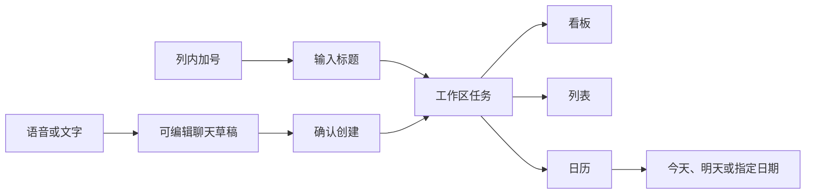

# 日程编排界面的设计取舍

[English](INTERFACE_RESEARCH.md) · 简体中文

在 iPad 上排一天的计划，最常见的三个问题是“这天已经排了什么”“哪些待办还没安排”“能不能说一句话，核对之后再放进日历”。下表的交互观察来自各产品的使用手册，最后一列是 DayWeave 的设计选择。

| 产品 | 实际交互 | DayWeave 的选择 |
| --- | --- | --- |
| [Structured](https://help.structured.app/en/articles/338178) | iPad 可以把收件箱展开在时间线旁边，轻点任务进入编辑。 | 横屏并排展示待办与日历。竖屏选中待办后收起列表，把目标日期和排入按钮露出来。 |
| [Things](https://culturedcode.com/things/support/articles/4001304/) | “今天”集中展示当日可执行的事项，晚间任务可以单独分组。 | 首页先展示当天任务，再展示阅读和提醒。上午、下午等粗略安排保留原有精度。 |
| [Fantastical](https://flexibits.com/fantastical-ios/help/calendar-views) | iPad 可以点日期跳转，或通过顶部控件切换视图，日期导航与下方日程联动。 | 在首页点周一至周日的任意一天即可进入当天编排。周视图、月视图都可以翻页。 |
| [Sunsama](https://help.sunsama.com/docs/usage-guides/timeboxing/) | 工作时段把任务和预计时长放进日历，触屏设备可以点开时段调整安排。 | 日程行展示时间、标题和预计时长，点整行即可编辑。 |
| [Akiflow](https://product.akiflow.com/articles/9441910-meet-aki-your-personal-assistant) | Aki 支持语音和文字，移动端日历也有语音入口。 | 在助手首屏放置带文字的语音入口。转写、修改草稿、确认创建分别由用户操作。 |

## 记录任务与安排日期

| 参考 | DayWeave 的交互 |
| --- | --- |
| 滴答清单支持先写标题，再到详情设置日期，也提供快捷日期入口。[快速开始](https://help.dida365.com/start) · [进阶使用](https://help.dida365.com/tips) | 点状态列顶端的加号即可录入标题。点卡片补充细节。在编排页选择今天或明天会保留时刻或时段。 |
| Trello 提供同一组卡片的多种视图，切换视图时保留筛选条件。[视图](https://trello.com/guide/activate-views) · [卡片筛选](https://support.atlassian.com/trello/docs/filtering-for-cards-on-a-board/) | 切换列表和看板会保留搜索与筛选。两种布局读取同一工作区的任务，打开同一个编辑器。 |
| Todoist 的看板按分区展示任务，已有视图可以切换布局。[看板布局](https://www.todoist.com/help/todoist/features/use-the-board-layout-in-todoist-AiAVsyEI) | 今天、本周都能切成看板。每列显示任务数，在列内创建会带入该状态。 |

用户提供的 Jira 截图影响了侧栏、蓝色选中态与浅灰列背景。竖屏时侧栏收起，看板可横向滑动。列内滚动时，加号仍留在列头。创建工作区时可以预览名称，并看清初始可见范围。[横屏看板](previews/ipad-landscape-board.png) · [竖屏看板](previews/ipad-portrait-board.png) · [创建工作区](previews/ipad-portrait-workspace.png)



## iPad 实际画面

| 横屏 | 竖屏 |
| --- | --- |
| [今日总览](previews/ipad-landscape.png) · [周日历](previews/ipad-landscape-planner.png) | [今日总览](previews/ipad-portrait.png) · [周日历](previews/ipad-portrait-planner.png) |
| [语音生成的可编辑草稿](previews/voice-draft-1180.png) | [邮箱注册](previews/ipad-register.png) · [语音生成的可编辑草稿](previews/voice-draft-820.png) |

首页日期下方最多三个圆点表示任务密度，朗读标签包含准确数量。周历的每个日期格预览两项任务，点日期会显示完整日程。未完成事项优先展示。只确定了周或月的任务保留在“日期待定”区。

## 前端技能

重做首页和日历的层次、字体和布局时，推荐 Anthropic 的 **frontend-design**。实现后检查表单、焦点、触屏操作和导航时，推荐 Vercel 的 **web-design-guidelines**。两者均可作为开发工具单独使用。[Frontend design](https://skills.sh/anthropics/skills/frontend-design) · [Web design guidelines](https://skills.sh/vercel-labs/agent-skills/web-design-guidelines)

```sh
npx skills add https://github.com/anthropics/skills --skill frontend-design
npx skills add https://github.com/vercel-labs/agent-skills --skill web-design-guidelines
```
