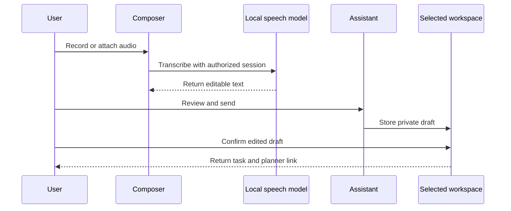

# DayWeave V1 design

English · [简体中文](V1_DESIGN.zh-CN.md) · [Open the interactive planner](design/planner.html?lang=en) · [View an editable chat draft on iPad](design/planner-ipad-chat.png)

**Design review · November 22, 2026.** This document defines the proposed V1 experience and the evidence required before release. The planner drawings use sample data. All dates below refer to the user's configured local timezone.

## 1. A day in DayWeave

**Try the design study.** Open the assistant at the top right, choose the sample dictation, revise the text and send it. Edit the draft, confirm it and follow the receipt to the scheduled task. The offline study uses a small set of example commands and resets to its sample data on reload. Sections 2 and 3 specify persistent drafts and actual microphone capture for the product.

On **Sunday, November 22, 2026**, the user dictates “Next week, spend an hour studying ROS2 tracing.” DayWeave transcribes the sentence into the composer. The user corrects a misheard term and presses **Send**.

The assistant proposes an editable task titled *Study ROS2 tracing*. Its estimate is 60 minutes and its planning window is **November 23–29**. The day, time and deadline fields are empty. The user adds the requirement to finish the notes by **Friday, November 27**, keeping the deadline at date precision. They can amend the title, attach a reference or cancel. Only **Confirm creation** creates the task and adds it to the planner.

On Monday, the user opens **This week**, taps the task from the week's unassigned list and selects **Thursday, November 26 · Afternoon**. Later they refine the slot to **14:00–15:00**. The task keeps its identity, linked references and Friday deadline through both moves. The receipt names the new slot and offers **Undo**. When asked what remains for Thursday, the assistant queries the same task record. Completing it from the dashboard updates the conversation's next query and the project view.

The first screen also brings together today's focus items, scheduled work, reading and viewing, and deadline reminders. Previously missed work has its own review list. The user chooses when it returns to the plan. With manual quick capture, pressing **Add** saves the task directly. A title alone creates an undated inbox task. An AI-proposed task follows **Edit → Confirm creation**. Both paths produce an ordinary local task with the same editing, scheduling and history controls.

## 2. Chat as an entry point for the whole workspace

Both the full chat page and the collapsible assistant expose the same actions. A **local action menu** lets a user set up their first provider, open the planner, upload a file or export data while inference is unavailable. With a model connected, natural-language requests select capabilities from the same registry.

| Area | What the user can request | Execution and visible outcome |
| --- | --- | --- |
| Dashboard and tasks | Query a date or view, capture an idea, edit details, pin, prioritize, complete, reopen, cancel, delete or split work | Reads query current records. New tasks appear as editable drafts. Other edits identify the target; successful writes carry a receipt. Deletion and groups of changes require review. |
| Planning and review | Inspect the backlog, move work into a week or month, assign a day or time, clear its schedule, generate a daily plan or review the week | A proposed plan lists time estimates, existing commitments and unknowns. Applying a multi-task plan requires confirmation. A single move identifies its destination and preserves the deadline. |
| Projects | List, create, inspect, rename, change status or target date, add or remove task and resource associations, delete | Details include linked work. Destructive requests identify the project and affected links. An unresolved dependency returns an explanation before deletion. |
| Library | Save or reuse a link, attach a local file, change metadata, record progress or notes, manage project links, schedule viewing or reading, remove a resource | The browser's file picker owns file selection. A scheduled resource creates one editable task draft. Video progress uses seconds, PDF progress uses pages. The user can open the original resource. |
| Preferences | Read or change language, timezone, theme, planning preferences, default provider, model and supported reasoning level | The response previews consequential settings changes. Accepted values come from the local settings service. Unsupported models, zones and reasoning levels have specific feedback. |
| Providers | Inspect provider status and model lists, test a connection, edit defaults and reasoning settings, connect or disconnect an account | A trusted local card collects the endpoint and masked key. OAuth opens the official authorization path. Disconnection names the affected account and requires an explicit choice. The assistant receives connection status and supported capabilities. |
| History and recovery | Find a change, request its undo, export workspace data, get backup and recovery guidance | History identifies the object, source, time and eligibility for undo. Undo checks the current version. Export uses a local download action. Full-volume backup and restore are deliberate administrator operations. |
| Conversations, voice and navigation | Open history, return to a draft, start a conversation, choose a model, dictate, or open a planner scope | Navigation targets and local controls come from a fixed allowlist. A provider can suggest an action card; activating the sensitive operation requires a user gesture. |

“What do I have tomorrow?” queries the tasks on record. “I have an hour this afternoon. Help me plan it” compares existing commitments, available time and estimates, then proposes what fits and shows what would be left over. “Break this task into three steps” produces editable drafts the user can select individually before confirming. A request like “Look into FastDDS sometime” proposes a task for the inbox and leaves the date open.

**Task draft lifecycle.** The server persists a pending draft in its conversation. **Edit** opens its fields in place. The card exposes title, project, priority, description, category, resource links, estimate, planning precision and deadline precision as applicable. A proposed exact slot and exact deadline are visible in the workspace timezone before confirmation. Draft edits display saving, saved or retry status. Opening the conversation on another device restores the last acknowledged version. Conflicting edits prompt a reload and review. Cancel leaves a cancelled receipt. **Confirm creation** validates the current version and writes the edited task, associations and change log in one transaction. Repeating confirmation returns the original result. A linked resource that still awaits creation commits with its task. The original card then becomes a receipt with an **Open task** action.

The executor requests clarification for ambiguous targets or unresolved dates. It shows conflicts such as a plan that extends beyond a deadline. The user can adjust the schedule or explicitly accept the conflict. A proposal, a committed change and a failed request each have a distinct status. Private form inputs go directly to the relevant local endpoint. API keys, OAuth tokens, raw audio, uploaded file bytes and bulk conversation exports stay outside tool arguments and model context.

## 3. Voice input on a desktop, phone or iPad

The microphone is a composer input. A tap starts recording after browser permission. Elapsed time and an active recording indicator remain visible. A second tap stops capture. The user can play back or discard the clip. Cancel releases the microphone and discards the clip. One recording accepts up to **120 seconds and 20 MiB**. Both the recording control and the receiving service enforce the limits.

The server runs a local multilingual **Whisper small** model using **CPU int8** inference. The deployment image carries a pinned, integrity-checked set of weights. The service authenticates the session, validates the container and decoded duration, bounds concurrent transcription and cleans up temporary server audio when processing completes, fails or is cancelled. It returns editable text. Only **Send** adds the reviewed message to the conversation. Users can edit mixed-language phrases and technical terms. [faster-whisper implementation and CPU inference](https://github.com/SYSTRAN/faster-whisper)

A physical iPad uses a trusted **HTTPS** origin on the personal LAN. The UI checks microphone and recording-format support at runtime. When direct recording is unavailable, the same control offers a local audio-file picker. If transcription fails, the composer preserves existing text and offers a retry using the browser's clip where available. Recording and transcription each have a cancel action. Voice testing includes iPad Safari's actual permission prompt, output format and interruption behavior. [MDN microphone access and secure contexts](https://developer.mozilla.org/en-US/docs/Web/API/MediaDevices/getUserMedia)

## 4. Planner interaction

| Scope | Calendar rule | How work appears |
| --- | --- | --- |
| Today / Tomorrow | The selected local date | Date-only tasks, named parts of day and actual clock slots stay distinguishable. |
| This week / Next week | Monday through Sunday, including weeks that cross a month or year | Seven labeled days and a separate list for work assigned to the entire week. Selecting a day refines the schedule. |
| This month | First through last local date of the calendar month | A calendar grid shows real day assignments. Work assigned to the month remains in a separate list until placed. Selecting a day opens its tasks. |
| Backlog | Tasks without a date or planning window | Available beside the working view on a wide screen and through an opener or drawer on smaller screens. |

The destination appears in the action itself and in the resulting receipt. For example, **Move to Thursday, November 26 · Afternoon** requires only a day and period. Exact start and end fields include the display timezone. Show overlapping commitments so the user can decide whether to keep an overlap. A floating week spanning two months is discoverable in both. A floating month appears at its own precision. Clearing the clock time keeps the selected calendar precision. Clearing the entire schedule returns the task to the backlog. The service checks version and deadline before saving. Undo restores the previous placement while it remains eligible.

Desktop users can select a backlog task and its destination without hiding the schedule. An iPad in landscape can show a compact backlog alongside the working view; portrait and split-screen use a drawer or sheet. The selection and destination remain visible through the change of layout. Dragging may shorten a mouse interaction. Tap-to-select, keyboard navigation, clearly labeled dates and a reachable save action complete the same operation. Touch targets should be at least 44 CSS pixels in each dimension for primary actions.

The interactive study and still images illustrate the proposed layout. [Open the planner study](design/planner.html?lang=en) · [Desktop design](design/planner-desktop.png) · [iPad design](design/planner-ipad.png) · [iPad time selection](design/planner-ipad-time.png)

## 5. Application, data and provider boundaries

Use one Docker Compose application on a Linux host. React, TypeScript, Vite, React Router and TanStack Query handle the browser experience. FastAPI and Pydantic validate requests. SQLAlchemy persists to SQLite, and Alembic versions the schema. Build the static frontend once and serve it from the same origin as REST and the authenticated SSE chat stream. One persistent volume contains the database, uploads and protected credential material. A separate local model cache can hold speech weights.

| Record or contract | Design commitment |
| --- | --- |
| Task and placement | A task has one active placement in V1. An inbox task has no anchor. A floating week or month has a type and a local anchor. A day has a local date and an optional named period. An exact slot adds timezone-aware start and end instants. Partial edits preserve fields the user did not change. |
| Deadline and estimate | A date-only deadline stays a local calendar date. An exact deadline stores an instant. Duration is an independent estimate in minutes. Retain exact instants when editing unrelated fields. Reject nonexistent wall-clock times and preserve the original instant when a repeated hour is unchanged. |
| Projects and resources | A task may belong to a project and link to several resources. Projects and resources support many-to-many association. Resource type determines progress units. Uploaded files have validated type, size, generated storage names and authenticated access. |
| Conversations, drafts and audit | Keep messages, provider/model identity, tool results, pending decisions, request IDs and changes in the local database. A before/after record captures source and conversation. Idempotent requests, optimistic versions and transactional writes protect retries and concurrent edits. |
| Capability registry | Each entry defines its typed input, result, permitted target, shared domain service, confirmation rule and optional localized UI action. The frontend and assistant invoke the same business rules. Limit context to recent messages, relevant facts and saved preferences. Treat external resource content as untrusted data. |
| Localization | Ship Simplified Chinese, Japanese and English across login, pages, fields, dates, errors, accessibility labels, assistant instructions, tools and decisions. Check i18next catalog coverage at build time. Keep stable API error codes and enum values. Pre-login language selection works locally. Persist the authenticated preference across devices. Preserve user-authored titles, notes and historical messages. Project documentation has English and Simplified Chinese editions. |

**What a remote model receives.** After an authenticated user sends a request, DayWeave selects the minimum local context needed to answer it and sends that context to the chosen provider. For “What is due tomorrow?” this can include the configured timezone and matching task titles, deadlines and states. Notes or resource excerpts enter the request only when relevant to the user's question. The local settings page identifies the provider, lets the user inspect the context selected for a request, and lists preferences they explicitly asked DayWeave to remember. They can clear those memories independently of tasks and conversation history. Raw audio and credentials stay outside the model input. Authentication keys and tokens are used by the backend only for the corresponding service connection.

Provider adapters own model discovery, capabilities, streaming, tool calling, credential lifecycle and actionable errors. Support OpenAI and DeepSeek API keys, an administrator-configured OpenAI-compatible endpoint and the official ChatGPT authorization route where the account and client qualify. Reasoning controls use the selected model's advertised options with an automatic default. For ChatGPT, complete the browser-local OAuth callback and protected transfer to the self-hosted server according to the official guide. Fetch the authorized account's model catalog and honor current Responses API preview parameters. Connection states distinguish missing credentials, an unverified configuration, connected, expired and unavailable. [OpenAI eligibility and registration](https://developers.openai.com/siwc/token-sharing-open-source.md) · [Self-hosted authorization](https://developers.openai.com/siwc/token-sharing-open-source/self-hosted-vms.md) · [Models and inference](https://developers.openai.com/siwc/token-sharing-open-source/models-and-inference.md) · [Preview limits](https://developers.openai.com/siwc/token-sharing-open-source/preview-limitations.md) · [DeepSeek API](https://api-docs.deepseek.com/)

## 6. Personal LAN access and company tailnet exclusion

**Only the host and approved devices on the personal physical LAN may reach DayWeave.** Company tailnet peers must be unable to reach even the login page over either IP family. Password authentication remains mandatory for approved devices.

1. Publish the application backend to host loopback only. A host HTTPS reverse proxy listens on the explicitly selected personal LAN address. Use a certificate trusted by the user's devices. Only this proxy may supply forwarded scheme and host information. The LAN listener stays closed until its address, interface, trust policy and firewall rules are verified.
2. Permit HTTPS only on the designated physical ingress interface from an approved personal subnet or device set. Deny tailnet ingress over IPv4 and IPv6, other interfaces, and unapproved sources. Cover host input and forwarded traffic. Docker port publishing can traverse DNAT and forwarding before ordinary host input rules run. Account for the active iptables or nftables backend, published-port translations, container bridge routes and direct access to the container address. Review all IP families and active bindings after a deployment. [Docker firewall behavior](https://docs.docker.com/engine/network/packet-filtering-firewalls/) · [Docker port publishing and direct routing](https://docs.docker.com/engine/network/port-publishing/)
3. Keep DayWeave out of Tailscale Serve and Funnel configuration, proxies, advertised application routes and public tunnels. Serve can forward a loopback service to tailnet peers, and Funnel can expose it beyond the tailnet. Excluding the service must preserve unrelated company networking on the host. [Tailscale Serve](https://tailscale.com/docs/features/tailscale-serve) · [Tailscale Funnel](https://tailscale.com/docs/features/tailscale-funnel)
4. Inspect the upstream network path. A company subnet router using source NAT can make a tailnet request arrive on the physical LAN with the router's LAN identity. Block that path at the router or deny its source at the ingress. If approved clients and company traffic share an indistinguishable source, isolate the personal service and devices on a separately controlled network. When provenance cannot be established, retain loopback-only operation. [Tailscale subnet router source NAT](https://tailscale.com/docs/features/subnet-routers)

Acceptance requires a successful authenticated connection from an approved physical LAN device and a failed connection from an independent company tailnet device. Use an authorized test path or the network administrator's equivalent configuration evidence. Include both address families where available, the host's LAN address through advertised subnet routes, the published application port, direct container routes and any existing proxy URL. Repeat after a host reboot and a container restart. Keep IPv6 ingress closed until equivalent controls are verified. Record unverified paths explicitly. Enable personal LAN ingress only after its applicable checks pass.

## 7. Implementation sequence and release gates

| Gate | Evidence required before proceeding |
| --- | --- |
| Chat capability coverage | Map every workspace operation to its manual control, chat entry and expected receipt. Exercise all three languages and first-provider setup through the local action menu. Use deterministic provider fixtures for repeatable tool and failure tests. Separately record model discovery and inference evidence from a real eligible account, plus expiry or reconnect behavior. Verify selected context, explicit-memory controls and the handling of test credentials. |
| Task creation and confirmation | Enter or dictate a request, edit the card, reload, resume elsewhere, cancel, confirm twice and open the created task. Verify zero tasks while a draft is pending and one after confirmation. Cover ambiguous names, linked resources, stale versions, disconnected providers and failed writes. Check manual quick capture separately. |
| Scheduling and dates | Move an inbox task through a floating week or month, a selected day, an exact slot, and back to the inbox. Undo the last move. Exercise the November example, Sunday-to-Monday rollover, month/year boundaries, timezone changes, DST gaps, named periods, date-only deadlines, conflicts and concurrent edits. |
| Touch and speech | Exercise desktop browsers, a phone and an iPad in portrait and landscape. Use real spoken samples in Chinese, Japanese and English with the local model. Cover silence, recording limits, permission denial, cancellation, retry and editing before Send. Check the microphone, keyboard, rotation, short viewports and trusted HTTPS on a physical iPad. |
| Self-hosting and recovery | Initialize a fresh installation. Migrate a copy of earlier data, build, start, log in, restart and check stored records, transcripts and file bytes. Inspect the portable export for test credentials. Restore a consistent database, uploads and matching encryption key into an isolated fresh volume and verify known records and files before switching volumes. |
| Network isolation | Record effective interface bindings for the deployment. Verify the authorized physical LAN, tailnet IPv4 and IPv6, subnet-routed LAN access, direct container paths and the absence of proxy exposure. Repeat the checks after restart and verify certificate trust on the iPad. |
| Review and publication | Keep design artifacts and implementation evidence distinguishable. After the user approves the implementation scope, develop and verify the agreed features. Publish reviewed source and synthetic examples to a feature branch, then open a pull request with reproducible results, remaining limitations and reference screenshots. The repository owner reviews and squash-merges the PR into protected main. |
