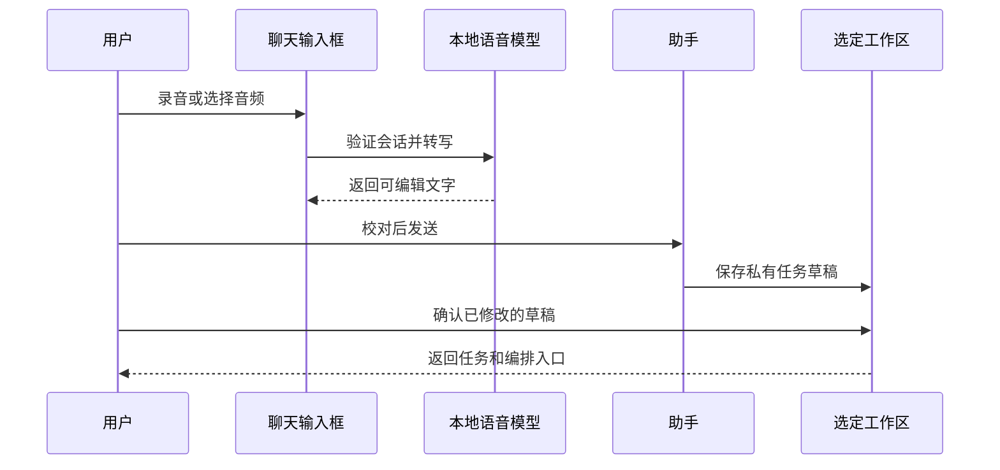

# DayWeave 第一版产品与交付设计

[English](V1_DESIGN.md) · 简体中文 · [打开可交互的聊天和日程编排设计稿](design/planner.html?lang=zh-CN) · [查看 iPad 聊天草稿](design/planner-ipad-chat.png)

**评审稿 · 2026 年 11 月 22 日。** 本文定义第一版应达到的使用体验、技术边界和验收标准。编排设计稿使用示例数据。现有浏览器截图和已通过的单项测试只覆盖其中一部分。

**试用设计稿。** 打开右上角的助手，点“模拟口述”，校对文字后发送，修改任务草稿，再点“确认创建”和回执上的按钮查看任务。设计稿离线运行，用固定规则展示几种对话，只在当前页面保存示例修改，刷新后复原。第 2、3 节描述正式版的草稿持久化和真实麦克风输入。

## 1. 用户一天怎么用

聊天是主要入口，日程编排页负责展示已有安排，让用户判断什么时候做。手动编辑和聊天操作共享同一份本地数据。

首页的手动快捷录入以“添加任务”为提交动作，适合记下已经想好的事项。经聊天推断出的标题和时间先进入草稿，让用户在提交前核对模型的理解。

例如，11 月 22 日星期日，用户口述“下周花一个小时研究 ROS2 tracing”。用户校对转写文字并发送。助手在消息内给出草稿，预计 60 分钟，计划范围是 11 月 23–29 日，具体哪天、几点留空。用户补上周五截止并确认。下周日历的“日期待定”出现这条任务。后来选周四下午，再细化到 14:00–15:00，始终更新同一条任务，周五的截止要求保留。

| 页面 | 用户首先能做什么 | 需要同时看到什么 |
| --- | --- | --- |
| 首页 | 开始下一项工作、快速记一条、打开助手 | 今日重点、已排时间与未定时任务、阅读观看、临期和此前未完成的事项 |
| 聊天 | 输入、口述，或选择工作区操作 | 原始指令、可修改的草稿或操作回执，以及受影响记录的入口 |
| 日程编排 | 选择要安排的日期或周期，放入一项待办 | 可选待办、当前放置目标、目标日期已有安排 |
| 项目和资料库 | 打开资料、续看、记录页码或查看项目 | 来源、个人笔记、关联任务、项目和进度 |
| 设置和历史 | 调整偏好、检查服务商、查看或撤销操作 | 真实连接状态、变更前后内容、操作来源 |

## 2. 聊天覆盖整个工作区

维护一份功能清单，每项都有稳定的操作标识、参数、权限、确认规则、执行方法和回执。新增功能同时登记页面入口、聊天入口及验收用例。聊天能判断用户想做什么，后端决定这项操作是否合法、是否已成功。

| 用户意图 | 聊天里的体验 | 成功依据 |
| --- | --- | --- |
| 创建工作、生活或阅读观看任务 | 展示可编辑草稿；含视频链接时可预览资料与观看安排 | 点击“确认创建”后写入。新资料和关联任务同时提交，重试只产生一份 |
| 查找、修改、置顶、完成、取消或改期 | 从数据库查询；多个同名任务显示候选；结果卡可以打开任务 | 返回记录 ID 和实际状态，任务页同步 |
| 排今天、明天、本周、下周或本月的工作 | 读取已排事项、截止、优先级、估时和可用时间，给出建议 | 建议可修改；批量应用前列出变更，确认后才写入 |
| 管理项目、资料、笔记和进度 | 支持新建、查改、关联和删除，上传时在聊天中打开本地文件选择器 | 项目详情和资料库可查到结果。删除需要确认 |
| 修改语言、时区、主题、规划偏好、默认模型或推理配置 | 展示拟修改的设置及新值，确认后应用 | 设置可重新读取；已有任务标题、个人笔记和历史消息保持原文 |
| 配置或测试服务商、连接或断开账号 | 聊天内提供遮罩密钥输入、连接测试、实际模型列表和官方授权引导 | 区分未配置、已授权、可读取模型、实际推理成功等状态；凭据由本地后端处理 |
| 回顾、撤销、导出、打开某个视图 | 展示变更记录、待确认操作或明确的本地按钮 | 撤销检查版本，导出排除凭据，返回原对话时保留上下文 |

“明天有什么要做？”直接查询并列出真实任务。“下午只有一小时，帮我排一下”会核对已有安排、可用时间和估时，把排得下的任务和暂时放不下的任务一起列出，用户可以调整建议。“把这个任务拆成三步”生成一组可逐条编辑、勾选的草稿，确认后只创建选中的任务。类似“有空研究 FastDDS”的想法直接给出收件箱草稿，无需用户编一个日期。

首次使用还没有 AI 服务商时，也可以在聊天里通过本地操作菜单或设置指令完成配置。密码、API Key、OAuth token、音频及上传文件的原始内容不进入模型工具参数。服务器防火墙、公司网络策略和灾难恢复由管理员在部署侧管理。

**创建卡片的生命周期**

1. 卡片直接显示标题、计划范围或日期、模糊时段或精确起止、截止、时长和优先级。项目、分类、备注和关联资料可以展开。
2. 行内修改自动保存到草稿，显示“保存中 / 已保存 / 需要重试”。刷新或换一台设备可以继续编辑已保存版本，任务列表此时还没有这条任务。
3. “确认创建”校验当前版本，把任务、关联关系和变更记录放在同一事务中写入。成功后原卡片变为只读，并提供“打开任务”。重复确认返回原结果。
4. 取消保留取消回执。遇到计划超过截止、同名对象、其他设备已修改或网络中断时，显示具体冲突，保留用户输入，让用户选择下一步。

## 3. 首版语音输入

输入框旁常驻麦克风按钮。点一次开始，再点停止，可试听或丢弃。转写结果放回输入框，允许改专有名词、日期和识别错误，用户再点发送。口述的建任务指令仍经过任务草稿确认；不会因停止录音而自动新增任务。

拟采用服务器本地的多语 Whisper small，CPU int8 推理。部署镜像带固定版本并校验完整性的权重。音频接口先验证管理员会话，再校验文件容器、实际解码时长、大小和并发。初始限制每段两分钟、20 MiB。录音和解码缓冲只作临时处理；用户实际发送的文字进入会话历史。

iPad 直接录音以受信任的局域网 HTTPS 为正式入口。用户拒绝权限、浏览器无法录音，或通过局域网 HTTP 打开时，同一位置提供音频文件选择。录音中和转写中分别显示状态，都能取消。识别失败保留已有文字，并在可行时保留当前录音供重试。浏览器模拟与真机麦克风分别验收。[浏览器麦克风使用条件](https://developer.mozilla.org/en-US/docs/Web/API/MediaDevices/getUserMedia) · [本地转写引擎](https://github.com/SYSTRAN/faster-whisper)

## 4. 独立的日程编排和日历

桌面和 iPad 横屏并排显示“待安排”和“当前计划”。iPad 竖屏优先保持日历及所选日详情可读，空间足够时保留两栏，空间紧张时一键展开待安排区。手机在“待安排 / 计划”之间切换，保留所选目标。助手临时展开后可以收起，回到原来的日程和位置。

| 范围 | 显示方式 | 没有选具体某一天时 |
| --- | --- | --- |
| 今天 / 明天 | 当日议程，分开显示未定时事项和按时刻排列的事项 | 排入所选本地日期 |
| 本周 / 下周 | 固定周一至周日的周历，格内显示任务或数量，点一天看详情 | 排入该周的“日期待定” |
| 本月 | 周一开头的月历，突出已有安排和当前所选日 | 排入该月的“日期待定” |

选择具体某天后，放置目标明确变成该日期。跨两个月的待定周任务在两个相交月份都能找到，只排到某月的任务不会凭空占用某一周。收件箱和以前漏做的任务可以分别筛选。

选好目标，点“排入”即可安排。点任务或时间可以改日期、上午/下午等时段、具体开始和结束。截止时间单独显示；有重叠时显示已有安排，用户可保留合理的重叠。移回收件箱只清除执行安排。每次移动都保留可撤销的历史；另一台设备有更新时先核对新版本。

品牌使用编织图形和英文 DayWeave 字标。主操作及图标按钮保留约 44 个 CSS 像素的触控区。核心操作不依赖拖拽、长按或鼠标悬停。软键盘打开时仍可滚动到确认动作；支持键盘焦点、深浅主题和减少动画。日历格放不下完整标题时，选中当天即可查看全名。[桌面设计稿](design/planner-desktop.png) · [iPad 设计稿](design/planner-ipad.png)

设计稿固定在 2026 年 11 月 18 日，切换范围始终得到相同的示例数据，便于比较布局。可以用 iPad 月历选一天查看安排，也可以打开时间编辑器，分别调整执行时间和截止日期。[iPad 横屏编辑时间](design/planner-ipad-time.png)

## 5. 本地数据和技术架构

使用单个 FastAPI 应用、React/TypeScript、SQLite 和 Alembic。前端通过 React Router 导航，通过 TanStack Query 同步状态。浏览器页面、业务 API 和聊天流同源。局域网 HTTPS 入口可以单独终止 TLS。数据库、上传文件、会话和凭据保存在 Linux 主机。

| 数据 | 规则 |
| --- | --- |
| 任务与项目 | 一个任务 ID，一套状态、优先级和估时；可选项目，可关联多份资料 |
| 执行安排 | 未安排、仅周/月、仅日期、日期加时段、精确时间段。调整精度时清理不再适用的旧字段 |
| 日期和时间 | 仅日期的值保留日期精度。精确时刻带偏移输入、按 UTC 存储；今天和明天按用户时区计算。周一为一周第一天 |
| 截止要求 | 日期或精确截止时刻二选一。除非用户明确修改，改执行安排保留截止要求 |
| 资料 | 链接或受控上传，记录来源、原因、备注、项目关联，以及视频秒数、PDF 页码或百分比 |
| 会话、草稿与工具 | 持久化会话、消息、服务商/模型、草稿版本、确认状态和执行回执；请求具有幂等标识 |
| 历史和设置 | 业务变更与前后快照同时提交，保存手动/AI 来源。凭据单独加密，前端只读取脱敏状态 |

AI 适配层支持 DeepSeek、OpenAI API Key、自定义兼容端点和符合官方条件的 ChatGPT 授权。上下文按需读取当前时区、语言、明确偏好、近期对话和相关记录。资料正文、任务标题等均作为数据处理。ChatGPT 需要官方资格、用户授权、真实模型目录和推理验证，不能以订阅状态代替验收。[官方自托管接入说明](https://developers.openai.com/siwc/token-sharing-open-source/self-hosted-vms)

使用远程模型时，后端会将已发送的消息、当前请求需要的上下文和相关工具结果交给所选服务商。设置页和聊天都能查看上下文来源，查看或清除已明确保存的长期偏好。录音在自托管服务器上转写。原始音频、原始上传文件和连接凭据均排除在模型上下文之外。切换模型后，任务、草稿和历史继续从本地数据库读取。

界面、后端错误和助手回复从框架层支持简体中文、日语、英语。i18next 使用三套目录，构建检查文案覆盖，日期和单位随语言格式化。登录前可选语言，登录后读取工作区偏好。项目文档默认英文，每份都有简体中文版。

## 6. 个人局域网与公司 Tailscale 的边界

**上线要求：个人局域网内授权设备可用，公司 tailnet 无法直接、经代理或经子网路由访问 DayWeave。** 公开 GitHub 仓库只包含源码、文档和合成示例。

1. 后端默认只对宿主机回环地址提供服务，使用专用应用网桥。需要 iPad 访问时，由局域网 HTTPS 入口绑定指定物理网卡上的明确地址。后端、管理接口和开发服务器都不发布到通配地址。IPv6 在具备等效规则前不开放。
2. 宿主机只放行回环和选定物理接口/子网进入应用端口的流量，拒绝包括 Tailscale 在内的其他入站接口。同时拦截从这些入口直接转发到应用容器的路径。Docker 发布端口时要按实际防火墙后端处理 DNAT 和转发，单独绑定局域网 IP 无法证明经子网路由的访问已被阻断。[Docker 端口发布](https://docs.docker.com/engine/network/port-publishing/) · [Docker 防火墙集成](https://docs.docker.com/engine/network/firewall-iptables/)
3. DayWeave 不注册 Tailscale Serve、Funnel、tailnet 名称或子网路由。安装过程不修改公司的全局 Tailscale 配置。若另一个子网路由器能将公司流量转发并做源地址转换，应由该路由的管理员拒绝 DayWeave 目的地址，或把应用放到无此路由的独立个人网络。仅靠应用登录或 HTTPS 无法证明网络隔离。[Tailscale Serve](https://tailscale.com/kb/1312/serve) · [Tailscale Funnel](https://tailscale.com/kb/1223/funnel)
4. 验收四条路径：物理局域网访问成功；Tailscale IPv4/IPv6 地址访问失败；经授权测试路径访问应用的局域网地址失败；直接路由到应用容器失败。核对无代理映射，重启主机或重建容器后规则仍生效。无法验证时，候选版本只提供回环访问。验证应使用获准的测试环境或管理员配置证据，不扫描无关公司设备。

使用受信任的 HTTPS 传输登录信息、API Key 和音频。业务导出排除密钥和上传文件字节。完整备份包含数据库、上传文件和匹配的加密密钥，需私人保管；恢复时先用新的空卷验证，再决定是否切换。

## 7. 实施顺序和验收门槛

| 阶段 | 通过条件 |
| --- | --- |
| 聊天功能覆盖 | 对每项工作区功能验证聊天入口，得到真实工具结果或正确的本地交互卡。覆盖三语及首次配置服务商 |
| 建任务闭环 | 输入和口述建任务、改草稿、刷新恢复、取消、重复确认、打开真实任务、查看回执。覆盖同名对象、旧版本和服务商失败 |
| 编排和时间 | 收件箱 → 周/月待定 → 某天 → 精确时段 → 移回收件箱 → 撤销。覆盖周日到周一、跨月跨年、时区切换及夏令时不存在的时刻 |
| 触屏与语音 | Playwright 实际点按桌面、iPad 两方向和手机；用中日英真实音频检查转写，覆盖静音、拒绝权限和重试；用受支持真机验证麦克风、软键盘和旋转 |
| 自托管与恢复 | 从已有卷迁移，构建、启动、登录、重启；核验文件字节和聊天记录；导出并从备份恢复 |
| 网络隔离 | 记录实际网卡和绑定，完成上述四条网络路径与重启验收，验证 iPad 信任局域网证书 |
| 交付 | 整体实现和核验完成后，再将审阅过的源码和合成截图推到功能分支，开 PR。受保护的 main 只经 PR squash merge，由仓库所有者合并 |

现有运行服务、开发工作区和上述发布目标是三个不同状态。部分手动流程、草稿和三语功能已有自动化测试。完整聊天操作集、独立编排页、端到端语音、真机 iPad 和网络隔离仍需要集成验收。真实云端推理及 ChatGPT 账号授权需要用户自己的凭据或授权。
