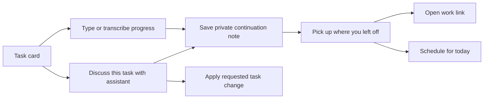

# Working from a task

English · [简体中文](WORKING_FROM_TASKS.zh-CN.md)

A useful task helps its owner start a piece of work, return to it after an interruption, and recognize the result. A test engineer, for example, may receive a Jira issue, follow a test plan, and deliver a log or a pull request. These can be three different destinations.

## First release

Paste one or more links into the task editor or an assistant draft. The Today list and task board expose a link directly on the task. A Jira issue link displays its issue key. The source site handles its own login when the user opens the link. The local card uses the saved URL and the supplied title. The daily planner also exposes destinations on its agenda rows.

Home quick capture can prepare a linked task from a URL or from a title and links. A standalone URL still offers a library-only action. In chat, the linked-task shortcut turns a pasted URL into an explicit draft request. The user can correct the proposal before confirmation.

When a task has multiple destinations, the owner can choose its *Primary work link*. A failing CI run, for example, can be the first link on the task even though the assignment originated in Jira. The other sources remain attached. A task with just one link needs no setup. Opening a destination leaves the task status under the user's control.

## Continue interrupted work

Use **Record progress** on a task to type a short note or transcribe audio into an editable field. Each account has its own note for the task. Today places the note beside the work link. The home page shows up to three recently noted, unplanned tasks under **Pick up where you left off**. Opening a link and scheduling the task for today are separate actions. Completed and cancelled tasks leave this section.

**Discuss with assistant** opens a conversation tied to the task and the signed-in account. On send, the assistant receives current task fields, linked resource names and the user's continuation note. It can change the task or record progress through the same services used by the editor. The server determines the target task from the conversation.

## What to try next

| Real task | Where work happens | What helps the next time | What counts as done |
| --- | --- | --- | --- |
| Investigate a build failure | Open the failing CI run; keep Jira as the request | “Reproduced on arm64. Next, compare the image manifests.” | A passing run or a documented finding |
| Write an onboarding guide | Open the editable document; keep the issue as background | “Environment setup is done. Add the container startup example.” | A shareable guide reviewed by its intended reader |
| Run a vehicle regression test | Open the test procedure or go to the test area | “Case 2 reproduced. Capture a log on the second run.” | A log and the observed test result |

**A follow-up date for blocked work.** A task waiting for another person can show the dependency and a chosen date to follow up. A separate, deliberate share action could let the owner hand over progress to a teammate.

**A result at completion.** When useful, let the user attach the resulting document, log or pull request as they complete the task. A result is optional. Offline and physical work can finish with a short observation or a single tap.

The assistant can suggest a next action from context the user has provided. It should distinguish an explicit user instruction from a guess. Reading a link, starting work and completing a task are three separate events. These design ideas are candidates for later releases.

## Try it with real work

Use a few existing tasks across two workdays. From Today on the iPad, count the taps before the relevant document, issue or test opens. Return to an unfinished task the next morning and check whether the owner can name the next action without searching chat history. At completion, see whether they can find the result a week later. Use these observations to choose the next change.
