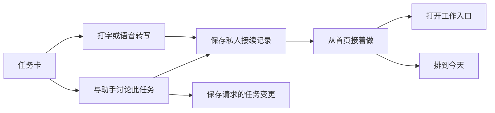

# 从待办进入实际工作

[English](WORKING_FROM_TASKS.md) · 简体中文

一条待办应当帮助使用者开工、中断后接着做，并知道最后交付了什么。例如，测试工程师从 Jira 接到问题，对照测试规程操作，最后交付日志或 PR。接需求、做事和交付可以发生在三个不同的地方。

## 首版交互

在任务编辑器或助手草稿里粘贴一个或多个链接。今日列表和看板直接显示任务的工作链接。Jira 工单链接会显示工单号。打开后由原网站处理登录，本地卡片使用已保存的 URL 和提供的标题。日程编排的当日议程也可以直接打开链接。

首页快捷录入支持用一个 URL 或「任务名称加链接」准备待办。只粘贴 URL 时也可以选择仅存资料。在聊天框粘贴 URL 后，可以点「创建关联待办」明确告诉助手要做什么，检查并修改草稿后再确认。

有多个目的地时，可以选定「主要工作入口」。例如任务虽然来自 Jira，开工要看的是失败的 CI 记录，就可以让 CI 排在最前面，工单和参考资料仍然保留。只有一个链接时直接打开，无须额外配置。打开链接后，任务状态仍由使用者决定。

## 接着做

在任务卡选择「记一下进展」，可以打字，也可以把语音转成可修改的文字。每个账号在同一项任务上都有自己的便签。今日任务在工作入口旁显示这条记录。首页的「接着做」展示最近留下记录、还没安排的最多三项任务。打开链接和排到今天分别操作，已完成或已取消的任务会退出这个列表。

选择「与助手讨论」打开绑定到这项任务和当前账号的会话。发送消息时，助手会收到最新任务字段、关联资料名称和本人的接续记录。助手通过与任务编辑器相同的服务修改任务或记录进展，服务端根据会话确定任务。

## 接下来值得试的交互

| 实际任务 | 去哪里做 | 中断后需要记住什么 | 完成的依据 |
| --- | --- | --- | --- |
| 排查构建失败 | 打开失败的 CI 记录，保留 Jira 作为需求来源 | 「arm64 已复现，下次比较两份镜像清单。」 | 通过的构建或有记录的排查结论 |
| 写入职文档 | 直接打开正在编写的文档，工单供查背景 | 「环境准备已写完，下一步补容器启动示例。」 | 可分享的文档，预期读者已审阅 |
| 跑车辆回归测试 | 打开测试规程，或到测试现场执行 | 「用例 2 已复现，第二次跑时抓日志。」 | 当次日志和实际观察到的结果 |

**给等待中的工作加上跟进日期。** 等待他人配合的任务可以记录在等什么，并指定再次跟进的日期。日后可以提供主动分享操作，将选定的进展交接给同事。

**完成时留下成果。** 使用者可以顺手挂上最终文档、日志或 PR，日后直接从已完成任务找回成果。成果选填。线下工作也可以只留一句观察，或直接点完成。

助手可以根据使用者给出的信息建议下一步，并标明哪些是建议。打开链接、开始工作和完成任务应当是三个独立动作。上述交互是后续版本的候选方向。

## 用实际工作验证

挑几条手头的真实任务，跨两个工作日使用。在 iPad 的「今天」记录打开正确文档、工单或测试记录需要点几次。第二天回到一项没做完的任务，看看能否直接说出下一步，是否还要翻聊天记录。一周后再从已完成任务找一次成果。用这些观察决定下一轮最值得改什么。
